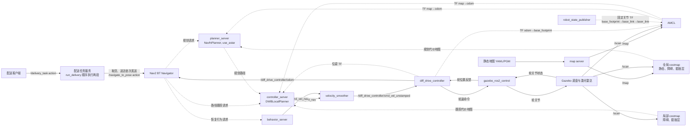

# 系统架构（静态地图导航与两站配送）

本图对应 `navigation.launch.py` 的静态地图定位和 Nav2 导航模式，以及另行启动的 `task_manager.launch.py`。实线标注 action、话题或控制接口；虚线表示模块内部调用或数据依赖，不表示两个方框之间有同名 ROS 话题。本图依据源码与配置核对，不代表本次重新运行了仿真。

## 关键连接与边界

1. [配送 action 接口](../src/delivery_task_interfaces/action/DeliveryTask.action)提供 map 坐标的取货与送达位姿。[`delivery_task_server.py`](../src/delivery_task_manager/delivery_task_manager/delivery_task_server.py)提供 `/delivery_task`，并作为 `/navigate_to_pose` 客户端；[`sequence.py`](../src/delivery_task_manager/delivery_task_manager/sequence.py)中的 `run_delivery()` 等取货成功后才进入送达。取消或单段超时会结束当前任务，不启动后续段。
2. [`navigation.launch.py`](../src/delivery_robot_bringup/launch/navigation.launch.py)以 `slam:=false`、`localization:=true`、`navigation:=true` 包含 [`mapping.launch.py`](../src/delivery_robot_bringup/launch/mapping.launch.py)。后者通过 Nav2 `localization_launch.py` 启动 map server 和 AMCL。[`amcl_localization.yaml`](../src/delivery_robot_bringup/config/amcl_localization.yaml)配置 `/scan`、`map→odom`；[`ros2_controllers.yaml`](../src/delivery_robot_bringup/config/ros2_controllers.yaml)配置差速控制器发布 `odom→base_footprint` 和里程计。`robot_state_publisher` 根据 [URDF](../src/delivery_robot_description/urdf/delivery_robot.urdf.xacro)发布固定关节 TF。
3. [`navigation.yaml`](../src/delivery_robot_bringup/config/navigation.yaml)中，Navfn 使用全局 costmap 规划，DWB 使用路径、局部 costmap 与机器人状态求速度。`/map` 与 `/scan` 先进入相应 costmap，不能把它们画成直接发给 Navfn 或 DWB 的话题。Navfn 的 `use_astar: true` 是现有插件配置，并非项目自行实现 A*。
4. [`mapping.launch.py`](../src/delivery_robot_bringup/launch/mapping.launch.py)把 controller server 和 behavior server 的速度输出重映射到 `/cmd_vel_nav`，再经 `velocity_smoother` 输出至 `/diff_drive_controller/cmd_vel_unstamped`。差速控制器使用轮位置反馈估计里程计；URDF 中的 `gazebo_ros2_control` 把轮关节接入 Gazebo。速度平滑器配置为 `OPEN_LOOP`，不能把它画成从里程计闭环取速。

本图只表示仿真中的已配置连接。现场节点、话题、TF 和实际参数是否生效，须在另行授权的运行中核验。
