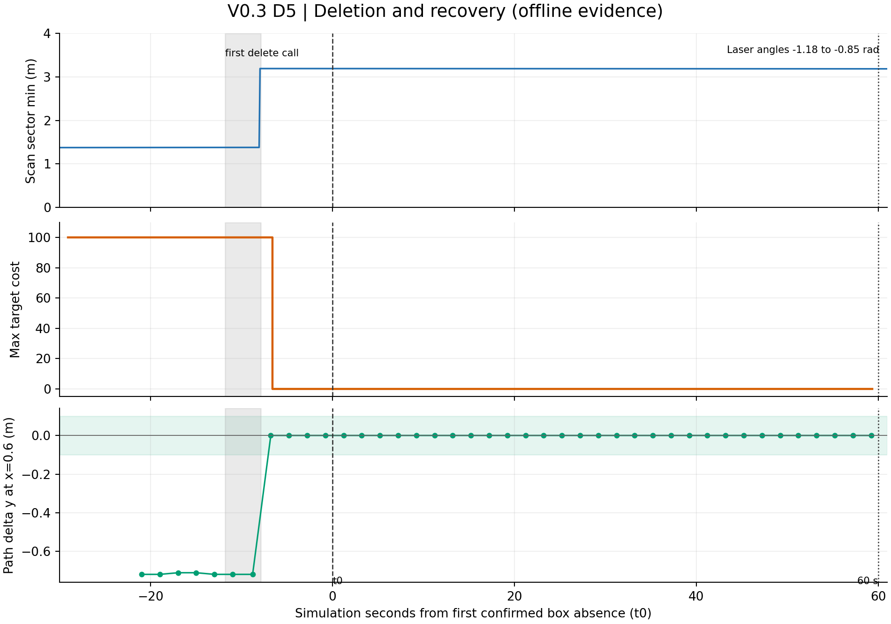
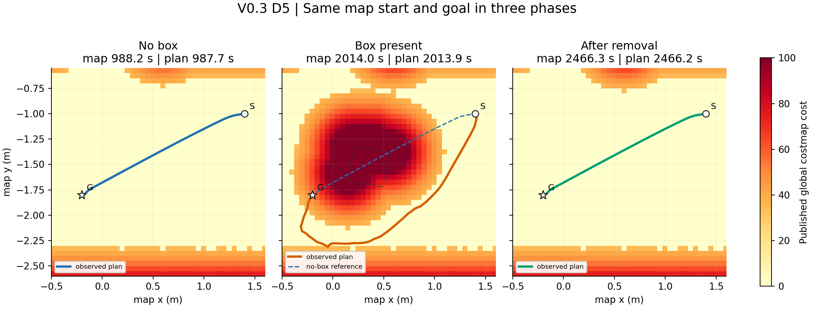

# V0.3 D7：障碍移除与恢复的离线图表展示（2026-11-03）

本页用**原始 bag 和规划 JSONL 生成的图表**展示时间顺序、全局代价地图与同一组 map 起终点路径。它不是 Gazebo/RViz 现场录像，也不替代操作者对画面的目视陈述。图表主体来自仓库外 `~/mobile_robot_delivery_acceptance_logs/D5_2026-11-03_recovery_run_001/`；数值判据及原始数据交叉核对见 [D5 离线验收](V0.3_D5_OFFLINE_ACCEPTANCE.md)。

## 删除时序



图的横轴是相对 **t0=2460.978 s 仿真时间**的秒数；t0 是 `/get_model_list` 第一次确认箱体不在列表中的响应 header，并非删除请求开始。灰带是首次删除服务请求至响应附近的**近似仿真区间**，由 Unix 墙钟与 bag `/clock` 接收时间近邻配对得到；虚线为 t0，点线为冻结的 t0+60 s 截止点。上图只画 `laser_link` 中 `[-1.18,-0.85] rad` 扇区的最小量程，不代表全部扫描；中图是 D2 同一批 **179 个目标格**在每张已发布全局 costmap 中的最大代价；下图是固定请求的路径在 `map x=0.6 m` 截面相对本轮无箱体基线路径的 y 差，淡绿带为 `±0.10 m` 恢复判据之一。地图与路径消息是离散采样，折线不表示采样间连续状态或内部 costmap 更新的精确时刻。

首次删除响应 `success=True`；t0 后 60 秒原窗口内的目标格保持低代价，bag 中有 40 张全局地图，窗口末三张均为 0。原窗口内有 30 次成功固定规划；在三张连续低代价地图之后，2466.2、2468.2 s 两次连续规划相对基线的截面 y 差、长度差和双向最大最近距离均为 0。图只画截面 y 差；其余两个路径量由 [D5 验收](V0.3_D5_OFFLINE_ACCEPTANCE.md)从完整路径计算，并非从图像目测。

## 相同起终点的三阶段地图与路径



三幅图来自 bag 中的 `/global_costmap/costmap`，显示相同的 `map` 坐标范围和色标。每幅标题分别给出地图 header 与相应规划结果的仿真秒数。白圆 **S** 为 map `(1.4,-1.0)`，白星 **G** 为 map `(-0.2,-1.8)`；三次请求均为 `use_start=true`、同一固定起终点。蓝线为无箱体基线；橙线在箱体出现后南绕，蓝色虚线是仅用于对照的基线；绿线是删除后恢复路径。中图虚线方框仅是 Gazebo world 箱体位姿经**近时刻** TF 推算的 map 外廓示意，不能当作精确同步模型真值或声称激光看到了整盒。箱体区域的高代价图与随后恢复的低代价图，与图中的路径变化相符；路径变化本身不是图层内部因果证明。

## 操作介入、两轮关系与限制

1. D5 轮由操作者启动仿真和 recorder、设置定位并发出箱体生成及**首次删除**服务请求；日志保存了服务响应、模型列表及箱体只读位姿。`navigation_console.log` 记录 AMCL 收到初始位姿，但该轮 `run_notes.txt` 未填写画面与点击细节，本页不声称亲眼看到 Gazebo/RViz。首次删除后的窗口末不满足主动清图分支门槛，目录没有操作者主动清图请求/响应；**无法排除其他客户端调用清图服务**，因此这里只能表述为“按已记录操作无主动清图的恢复”，不能写“已排除清图影响”或“清图后恢复”。
2. D3-c 是另一次独立运行：首次确认缺席的窗口为 `[979.744,1039.744] s`，原窗口内的目标格连续三张清除地图和两次恢复规划见 [D3-d 审计](V0.3_D3D_OFFLINE_AUDIT.md)。D3-b 的原窗口只有一次恢复规划，仍是证据不足的尝试；不能把这三次记录合写成“所有运行稳定复现”。两轮 world→map 估计和 costmap 发布时刻不同，图中 D5 的地图格不能直接与 D3-c 固定数组索引逐格相减。
3. 历史 C6 在箱体删除、扫描回波和局部地图清除后，全局箱体邻域高代价仍持续到其 bag 最后一张；[C6 证据边界审计](V0.3_D4_C6_HISTORICAL_EVIDENCE_AUDIT.md)确认其来源和最终消退时间未知。D5 的正常清除**不表示 C6 已修复**。早期超时运行约 0.15 rad 持续同向 odom 偏航也仍未解，本图表没有检验该风险。

## 图表来源与复现

- PNG 用于直接阅读；同名 [SVG 时序图](figures/v03_d7_deletion_timeline.svg) 与 [SVG 地图路径图](figures/v03_d7_maps_paths.svg) 可缩放。图表在仓库内，原始 bag、日志、规划 JSONL 仍在仓库外，不随本仓库 GitHub 备份。
- [生成脚本](v03_d7_make_figures.py)只读打开停止后的 bag，对九话题中相关的 `/clock`、`/scan`、全局地图和 `/plan` 解码；它先验证 SQLite 完整性、原窗口长度、目标格数量，并将 bag 的 64 条 `/plan` 与四份 JSONL 成功结果逐点核对，然后生成图表。[provenance JSON](figures/v03_d7_provenance.json)记录输入 SHA-256 和实际选择的仿真时间。
- 本机复现命令：

  ```bash
  source /opt/ros/humble/setup.bash
  python3 docs/v03_d7_make_figures.py \
    --run-dir "$HOME/mobile_robot_delivery_acceptance_logs/D5_2026-11-03_recovery_run_001" \
    --out-dir docs/figures
  ```

**D7 判定：**清晰图表已覆盖时间顺序、三阶段全局地图与同起终点路径，正文明确操作介入、新旧证据边界和历史 C6 限制，满足冻结的 D7 条目，计 **5/5**。本次未启动仿真、未补录视频，不计 D8。
